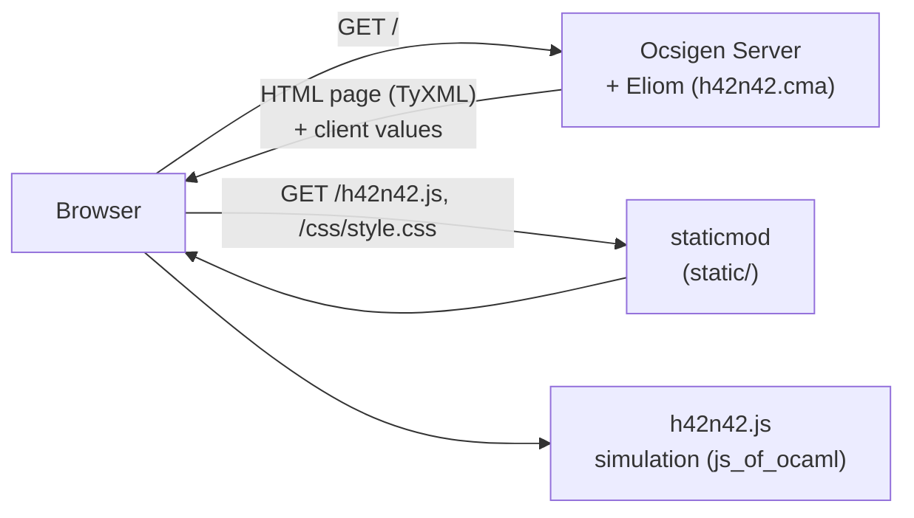
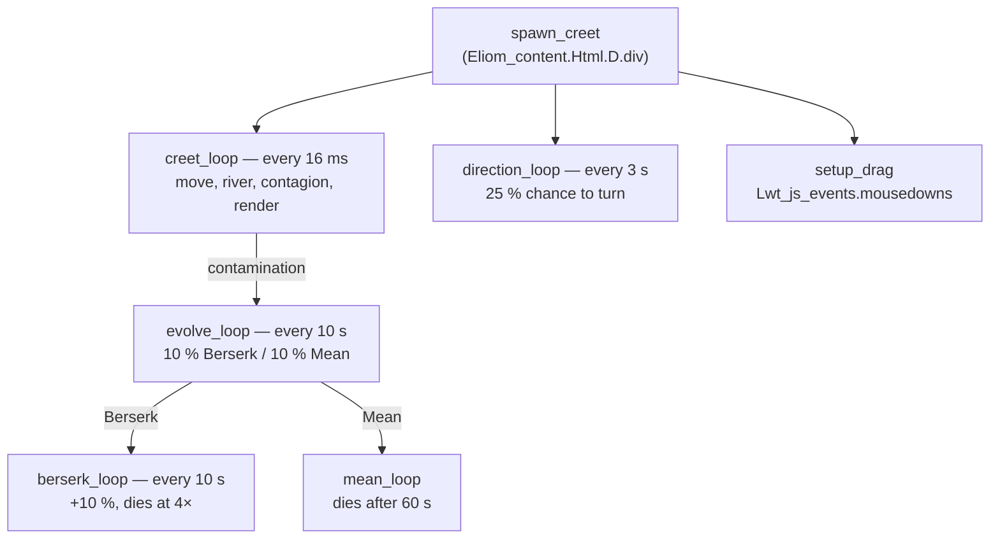
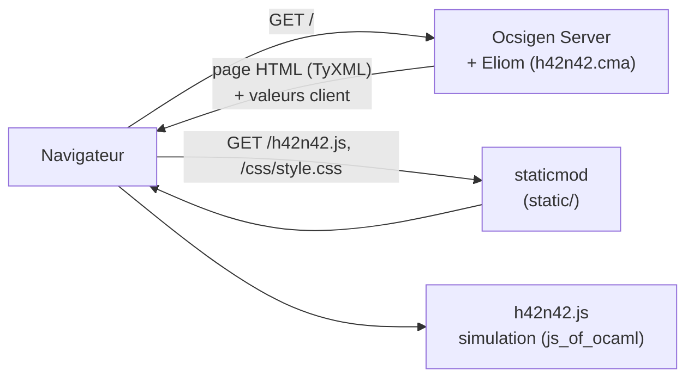
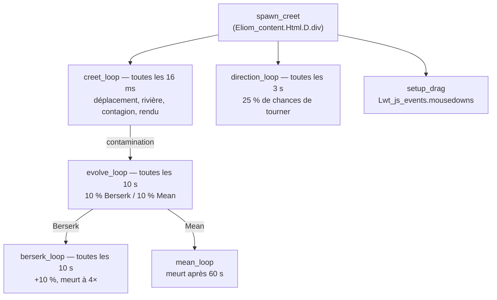

<div align="center">

# H42N42
### Simulate the life of a population of creatures threatened by a terrifying virus, in OCaml with Ocsigen.

[![Contributors][contributors-shield]][contributors-url]
[![Forks][forks-shield]][forks-url]
[![Stargazers][stars-shield]][stars-url]
[![Issues][issues-shield]][issues-url]
[![License][license-shield]][license-url]
[![LinkedIn][linkedin-shield]][linkedin-url]

</div>

---

## 🇬🇧 English

<details>
<summary><b>📖 Click to expand/collapse English version</b></summary>

### 📋 Table of Contents

- [About](#about)
- [Skills Learned](#skills-learned)
- [Approach](#approach)
- [Project Structure](#project-structure)
- [Installation](#installation)
- [Usage](#usage)
- [Tests](#tests)
- [Credits](#credits)

---

<a name="about"></a>

### 📖 About

The river has been polluted by H42N42, a deadly and highly infectious virus. Creatures called **Creets** wander in a rectangular land: the player must keep the healthy ones away from the toxic river and drag the sick ones to the hospital before they contaminate everyone.

The whole application is written in OCaml with the [Ocsigen](https://ocsigen.org) project:

| Part | Technology | Role |
|------|------------|------|
| Server | Eliom, Ocsigen Server | Generates the page with TyXML (`Eliom_content.Html.D`): the HTML is statically validated at compile time. |
| Client | Eliom `[%%client]`, js_of_ocaml | The whole simulation, compiled from OCaml to JavaScript. |
| Threads | Lwt | Every Creet is driven by its own cooperative threads. |
| Mouse | `Lwt_js_events` | Drag and drop. |

**Rules**

| Creet | Colour | Behaviour |
|-------|--------|-----------|
| Healthy | green | Moves in a straight line at constant speed, sometimes changes direction, bounces on the edges. Never dies of old age. |
| Sick | orange | 15 % slower. Each contact with a healthy Creet has a 2 % chance per iteration to contaminate it. |
| Berserk | red | Grows by 10 % every 10 s and dies at 4× its size (2 min 30). Cannot be grabbed nor healed. |
| Mean | purple | 15 % smaller, chases the nearest healthy Creet, dies after 1 minute. Cannot be grabbed nor healed. |

- **River** (top): any Creet touching it becomes sick immediately.
- **Drag and drop**: a healthy or sick Creet can be dropped anywhere, even outside the play area. While held, it cannot be contaminated.
- **Hospital** (bottom): a sick Creet *dropped by the player* is healed. A sick Creet wandering in on its own is not.
- **Mutation**: every 10 s, a sick Creet has 10 % chance to become Berserk and 10 % to become Mean, for good.
- **Births**: a new Creet is born every 5 s as long as one healthy Creet remains.
- **Difficulty**: all Creets speed up by 0.3 % per second (×1.2 after one minute, ×6 after ten).
- **Game over**: when no healthy Creet is left, the simulation stops and **GAME OVER** is displayed.

**Additional features**

- Live statistics: Creets per state, elapsed time and speed multiplier.
- *Play again* button and survival time on the GAME OVER screen.
- Animations for birth, contamination, mutation and healing, and a ring around the held Creet.
- A held Creet that mutates is released automatically.
- 113 unit tests and 15 end-to-end browser tests.

---

<a name="skills-learned"></a>

### 🧠 Skills Learned

- Running an OCaml program in a browser with js_of_ocaml.
- Writing a client/server Eliom application in a single `.eliom` file (`[%%shared]`, `[%%client]`, `[%client ...]` and `~%` injections).
- Generating statically validated HTML with TyXML.
- Calling the DOM and JavaScript methods from OCaml.
- Programming mouse handlers with `Lwt_js_events`.
- Writing cooperative threads in monadic style with Lwt (`let%lwt`, `Lwt.pick`, `Lwt.wait`).
- Building an Eliom project with dune and containerising it with Docker.
- Testing a browser game end to end with a simulated clock (Playwright).

---

<a name="approach"></a>

### 🗺️ Approach

**Architecture**



The server only builds the page: play area, river, hospital, GAME OVER screen and legend. The elements are created with `Eliom_content.Html.D`, sized from the constants of `logic.ml`, then injected into the client with `~%`. `[%client (start ~area:~%area ...)]` starts the game when the page loads.

**Threads of a Creet**



Global threads handle births (every 5 s), the clock and acceleration (every second), and the game over check.

**Separating rules from display**

`src/logic.ml` holds every rule of the game without DOM nor Lwt: movement, bounces, precise contact between circles, contamination, healing, mutations, game over. It is shared by the server, the client and the native tests. The client only adds the threads and the rendering.

**Notable details**

- **Precise contact**: two Creets touch when the distance between their centres is strictly below the sum of their radii.
- **Bounces**: when a circle goes past an edge while moving away from it, the matching direction component is reversed (angle of incidence = angle of reflection). The position is never clamped, so a Creet dropped outside the area comes back by itself.
- **One contamination, one evolution loop**: every contamination starts its own check loop, numbered. If the Creet is healed then infected again, the old loop stops by itself.
- **Releasing a mutating Creet**: if a held Creet becomes Berserk or Mean, an `Lwt.wait` wakes up the drag loop and the Creet is released.
- **Visual feedback**: a ring when held, and separate animations for contamination, mutation, healing and birth.

**Versions**

OCaml 5.2, Eliom 11.1.1, js_of_ocaml 5.9.1, Ocsigen Server 6.0.0. This is the most recent combination that installs: Eliom ≥ 10 no longer installs on OCaml 4.14.3, and Eliom 12 requires `wasm_of_ocaml`, whose binaryen version is not available on Ubuntu 22.04.

---

<a name="project-structure"></a>

### 📂 Project Structure

```
ft_h42n42/
├── src/
│   ├── h42n42.eliom        # Eliom app: page (server) and simulation (client)
│   ├── logic.ml            # Pure game rules, shared by server, client and tests
│   ├── dune                # Server libraries
│   ├── client/dune         # Client program compiled to JavaScript
│   └── tools/dune          # Client-side Eliom preprocessor
├── static/
│   ├── css/style.css       # State colours, animations, GAME OVER screen
│   └── favicon.svg
├── tests/
│   ├── test_logic.ml       # 113 Alcotest unit tests
│   └── e2e/test_game.py    # 15 end-to-end tests in Chromium (Playwright)
├── readme/h42n42.png       # Header image
├── h42n42.conf.in          # Ocsigen Server configuration template
├── dune-project
├── Makefile
├── Dockerfile
├── docker-compose.yml
└── LICENSE
```

---

<a name="installation"></a>

### 🚀 Installation

**Prerequisites**

- [Docker](https://docs.docker.com/get-docker/) and Docker Compose

No OCaml installation is needed on the host.

```bash
git clone https://github.com/HaruSnak/ft_h42n42.git
cd ft_h42n42
docker-compose up --build
```

The first build installs OCaml and the Ocsigen libraries (several minutes), compiles the project and runs the unit tests. Later builds reuse the Docker cache.

**Without Docker**, in an opam switch containing `eliom.11.1.1`, `ocsipersist-sqlite` and `alcotest`:

```bash
make        # compiles the client, the server modules and h42n42.conf
make run    # starts ocsigenserver.opt on port 8080
```

| Rule | Effect |
|------|--------|
| `all` | Builds `static/h42n42.js`, `local/lib/*.cma/.cmxs` and `h42n42.conf`. Rebuilds only what changed. |
| `run` | `all`, then starts the server. |
| `test` | Runs the unit tests. |
| `clean` | Removes intermediate files (`_build/`). |
| `fclean` | `clean` + removes the JavaScript, the server modules and the generated configuration. |
| `re` | `fclean` then `all`. |

---

<a name="usage"></a>

### 💻 Usage

Open **http://localhost:8080** in a browser.

| Action | Effect |
|--------|--------|
| Click and drag a healthy Creet | Moves it away from danger. It cannot be contaminated while held. |
| Drop a sick Creet in the hospital | Heals it. |
| Drop a Creet outside the area | It resumes its movement from there and comes back. |
| **Play again** | Starts a new game after a GAME OVER. |

The line under the play area shows live the number of Creets in each state, the elapsed time and the speed multiplier.

**Docker setup**

| Element | Role |
|---------|------|
| `8080:8080` | Port of the application. |
| `./static/css` volume | CSS changes are served without rebuilding the image. |
| `h42n42-logs` volume | Ocsigen logs are kept between restarts. |
| `restart: unless-stopped` | The server restarts automatically. |

To stop: `Ctrl+C`, then `docker-compose down`.

---

<a name="tests"></a>

### 🧪 Tests

```bash
make test                                                 # unit tests (also run by the Docker build)
pip install pytest playwright && playwright install chromium
H42N42_URL=http://localhost:8080/ python3 -m pytest tests/e2e -v   # end to end (~10 min, server running)
```

**Unit tests** (113): precise contact, bounces and reflection angle, 15 % slowdown, contamination at 2 % checked statistically, river, healing, mutations at 10 % / 10 %, Berserk growth and death at 2 min 30, Mean pursuit, acceleration curve, game over and the subject constants.

**End-to-end tests** (15): they drive the real game in Chromium. The game clock is controlled with Playwright's simulated clock, so the game can be frozen, played with the mouse, then advanced by an exact duration. They cover:

- the page generated by Eliom and the absence of console errors;
- the initial population, colours, straight lines at constant speed, births every 5 s and acceleration;
- drag and drop, invulnerability in the river and on contact, instant colour change and measured slowdown (0.85);
- healing only when dropped, and dropping outside the area;
- GAME OVER and *Play again*;
- 6 minutes of real-time play: Berserk growth and death, Mean lifetime and pursuit, no spontaneous healing, Berserk and Mean cannot be grabbed.

---

<a name="credits"></a>

### 📖 Credits

- **42 School** — subject
- **Ocsigen**: [ocsigen.org](https://ocsigen.org) — Eliom, js_of_ocaml, Lwt, TyXML and their tutorials
- **Eliom distillery**: the dune build follows the official `app.lib` template

### 📄 License

This project is licensed under the **MIT License** — see the [LICENSE](LICENSE) file for details.

</details>

---

## 🇫🇷 Français

<details>
<summary><b>📖 Cliquez pour développer/réduire la version française</b></summary>

### 📋 Table des matières

- [À propos](#à-propos)
- [Compétences acquises](#compétences-acquises)
- [Approche](#approche-fr)
- [Structure du projet](#structure-du-projet)
- [Installation](#installation-fr)
- [Utilisation](#utilisation)
- [Tests](#tests-fr)
- [Crédits](#crédits)

---

<a name="à-propos"></a>

### 📖 À propos

La rivière a été polluée par H42N42, un virus mortel et très contagieux. Des créatures appelées **Creets** se promènent sur une terre rectangulaire : le joueur doit éloigner les saines de la rivière toxique et déposer les malades à l'hôpital avant qu'elles ne contaminent tout le monde.

Toute l'application est écrite en OCaml avec le projet [Ocsigen](https://ocsigen.org) :

| Partie | Technologie | Rôle |
|--------|-------------|------|
| Serveur | Eliom, Ocsigen Server | Génère la page avec TyXML (`Eliom_content.Html.D`) : le HTML est validé statiquement à la compilation. |
| Client | Eliom `[%%client]`, js_of_ocaml | Toute la simulation, compilée d'OCaml vers JavaScript. |
| Threads | Lwt | Chaque Creet est piloté par ses propres threads coopératifs. |
| Souris | `Lwt_js_events` | Glisser-déposer. |

**Règles**

| Creet | Couleur | Comportement |
|-------|---------|--------------|
| Sain | vert | Avance en ligne droite à vitesse constante, change parfois de direction, rebondit sur les bords. Ne meurt jamais de vieillesse. |
| Malade | orange | 15 % plus lent. Chaque contact avec un Sain a 2 % de chances par itération de le contaminer. |
| Berserk | rouge | Grossit de 10 % toutes les 10 s et meurt à 4 fois sa taille (2 min 30). Ne peut être ni saisi ni soigné. |
| Mean | violet | 15 % plus petit, poursuit le Creet sain le plus proche, meurt au bout d'une minute. Ne peut être ni saisi ni soigné. |

- **Rivière** (en haut) : tout Creet qui la touche tombe malade immédiatement.
- **Glisser-déposer** : un Creet sain ou malade peut être déposé n'importe où, même hors de la zone de jeu. Tant qu'il est tenu, il ne peut pas être contaminé.
- **Hôpital** (en bas) : un Creet malade *déposé par le joueur* est guéri. Un malade qui y entre tout seul ne l'est pas.
- **Mutation** : toutes les 10 s, un Creet malade a 10 % de chances de devenir Berserk et 10 % de devenir Mean, définitivement.
- **Naissances** : un nouveau Creet naît toutes les 5 s tant qu'il reste un Creet sain.
- **Difficulté** : tous les Creets accélèrent de 0,3 % par seconde (×1,2 après une minute, ×6 après dix).
- **Fin de partie** : quand il ne reste plus aucun Creet sain, la simulation s'arrête et **GAME OVER** s'affiche.

**Fonctionnalités supplémentaires**

- Statistiques en direct : Creets par état, temps écoulé et multiplicateur de vitesse.
- Bouton *Play again* et durée de survie sur l'écran GAME OVER.
- Animations de naissance, de contamination, de mutation et de guérison, et halo autour du Creet tenu.
- Un Creet tenu qui mute est lâché automatiquement.
- 113 tests unitaires et 15 tests de bout en bout dans le navigateur.

---

<a name="compétences-acquises"></a>

### 🧠 Compétences acquises

- Exécuter un programme OCaml dans un navigateur avec js_of_ocaml.
- Écrire une application client/serveur Eliom dans un seul fichier `.eliom` (`[%%shared]`, `[%%client]`, `[%client ...]` et injections `~%`).
- Générer du HTML validé statiquement avec TyXML.
- Manipuler le DOM et appeler des méthodes JavaScript depuis OCaml.
- Programmer des gestionnaires d'événements souris avec `Lwt_js_events`.
- Écrire des threads coopératifs en style monadique avec Lwt (`let%lwt`, `Lwt.pick`, `Lwt.wait`).
- Compiler un projet Eliom avec dune et le conteneuriser avec Docker.
- Tester un jeu dans le navigateur de bout en bout avec une horloge simulée (Playwright).

---

<a name="approche-fr"></a>

### 🗺️ Approche

**Architecture**



Le serveur ne fait que construire la page : zone de jeu, rivière, hôpital, écran GAME OVER et légende. Les éléments sont créés avec `Eliom_content.Html.D`, dimensionnés à partir des constantes de `logic.ml`, puis injectés dans le client avec `~%`. `[%client (start ~area:~%area ...)]` lance la partie au chargement de la page.

**Threads d'un Creet**



Des threads globaux gèrent les naissances (toutes les 5 s), le chronomètre et l'accélération (chaque seconde), et la détection de fin de partie.

**Règles séparées de l'affichage**

`src/logic.ml` contient toutes les règles du jeu, sans DOM ni Lwt : déplacement, rebonds, contact précis entre cercles, contamination, guérison, mutations, fin de partie. Il est partagé par le serveur, le client et les tests natifs. Le client n'ajoute que les threads et le rendu.

**Détails notables**

- **Contact précis** : deux Creets se touchent quand la distance entre leurs centres est strictement inférieure à la somme de leurs rayons.
- **Rebonds** : quand un cercle dépasse un bord en s'en éloignant, la composante de direction correspondante est inversée (angle d'incidence = angle de réflexion). La position n'est jamais recalée : un Creet déposé hors de la zone y revient de lui-même.
- **Une contamination, une boucle d'évolution** : chaque contamination lance sa propre boucle de contrôle, numérotée. Si le Creet est guéri puis recontaminé, l'ancienne boucle s'arrête d'elle-même.
- **Lâcher un Creet qui mute** : si un Creet tenu devient Berserk ou Mean, un `Lwt.wait` réveille la boucle de glisser-déposer et le Creet est lâché.
- **Retours visuels** : un halo quand il est tenu, et des animations distinctes pour la contamination, la mutation, la guérison et la naissance.

**Versions**

OCaml 5.2, Eliom 11.1.1, js_of_ocaml 5.9.1, Ocsigen Server 6.0.0. C'est la combinaison la plus récente qui s'installe : Eliom ≥ 10 ne s'installe plus sur OCaml 4.14.3, et Eliom 12 exige `wasm_of_ocaml`, dont la version de binaryen n'existe pas sur Ubuntu 22.04.

---

<a name="structure-du-projet"></a>

### 📂 Structure du projet

```
ft_h42n42/
├── src/
│   ├── h42n42.eliom        # Application Eliom : page (serveur) et simulation (client)
│   ├── logic.ml            # Règles du jeu pures, partagées par serveur, client et tests
│   ├── dune                # Bibliothèques serveur
│   ├── client/dune         # Programme client compilé en JavaScript
│   └── tools/dune          # Préprocesseur Eliom côté client
├── static/
│   ├── css/style.css       # Couleurs des états, animations, écran GAME OVER
│   └── favicon.svg
├── tests/
│   ├── test_logic.ml       # 113 tests unitaires Alcotest
│   └── e2e/test_game.py    # 15 tests de bout en bout dans Chromium (Playwright)
├── readme/h42n42.png       # Image d'en-tête
├── h42n42.conf.in          # Modèle de configuration d'Ocsigen Server
├── dune-project
├── Makefile
├── Dockerfile
├── docker-compose.yml
└── LICENSE
```

---

<a name="installation-fr"></a>

### 🚀 Installation

**Prérequis**

- [Docker](https://docs.docker.com/get-docker/) et Docker Compose

Aucune installation d'OCaml n'est nécessaire sur la machine hôte.

```bash
git clone https://github.com/HaruSnak/ft_h42n42.git
cd ft_h42n42
docker-compose up --build
```

Le premier build installe OCaml et les bibliothèques Ocsigen (plusieurs minutes), compile le projet et lance les tests unitaires. Les builds suivants réutilisent le cache Docker.

**Sans Docker**, dans un switch opam contenant `eliom.11.1.1`, `ocsipersist-sqlite` et `alcotest` :

```bash
make        # compile le client, les modules serveur et h42n42.conf
make run    # lance ocsigenserver.opt sur le port 8080
```

| Règle | Effet |
|-------|-------|
| `all` | Produit `static/h42n42.js`, `local/lib/*.cma/.cmxs` et `h42n42.conf`. Ne recompile que ce qui a changé. |
| `run` | `all`, puis lance le serveur. |
| `test` | Lance les tests unitaires. |
| `clean` | Supprime les fichiers intermédiaires (`_build/`). |
| `fclean` | `clean` + supprime le JavaScript, les modules serveur et la configuration générée. |
| `re` | `fclean` puis `all`. |

---

<a name="utilisation"></a>

### 💻 Utilisation

Ouvrez **http://localhost:8080** dans un navigateur.

| Action | Effet |
|--------|-------|
| Cliquer-glisser un Creet sain | L'éloigne du danger. Il ne peut pas être contaminé tant qu'il est tenu. |
| Déposer un Creet malade dans l'hôpital | Le guérit. |
| Déposer un Creet hors de la zone | Il repart de là et revient de lui-même. |
| **Play again** | Lance une nouvelle partie après un GAME OVER. |

La ligne sous la zone de jeu affiche en direct le nombre de Creets dans chaque état, le temps écoulé et le multiplicateur de vitesse.

**Configuration Docker**

| Élément | Rôle |
|---------|------|
| `8080:8080` | Port de l'application. |
| Volume `./static/css` | Les modifications du CSS sont servies sans reconstruire l'image. |
| Volume `h42n42-logs` | Les journaux d'Ocsigen sont conservés entre deux redémarrages. |
| `restart: unless-stopped` | Le serveur redémarre automatiquement. |

Pour arrêter : `Ctrl+C`, puis `docker-compose down`.

---

<a name="tests-fr"></a>

### 🧪 Tests

```bash
make test                                                 # tests unitaires (lancés aussi par le build Docker)
pip install pytest playwright && playwright install chromium
H42N42_URL=http://localhost:8080/ python3 -m pytest tests/e2e -v   # bout en bout (~10 min, serveur lancé)
```

**Tests unitaires** (113) : contact précis, rebonds et angle de réflexion, ralentissement de 15 %, contamination à 2 % vérifiée statistiquement, rivière, guérison, mutations à 10 % / 10 %, croissance et mort du Berserk à 2 min 30, poursuite du Mean, courbe d'accélération, fin de partie et constantes du sujet.

**Tests de bout en bout** (15) : ils pilotent le vrai jeu dans Chromium. Le temps du jeu est contrôlé par l'horloge simulée de Playwright : on peut figer la partie, agir à la souris, puis avancer le temps d'une durée exacte. Ils couvrent :

- la page générée par Eliom et l'absence d'erreur dans la console ;
- la population initiale, les couleurs, les lignes droites à vitesse constante, les naissances toutes les 5 s et l'accélération ;
- le glisser-déposer, l'invulnérabilité dans la rivière et au contact, le changement de couleur instantané et le ralentissement mesuré (0,85) ;
- la guérison uniquement par dépôt, et le dépôt hors de la zone ;
- le GAME OVER et *Play again* ;
- 6 minutes de partie en temps réel : croissance et mort des Berserk, durée de vie et poursuite des Mean, aucune guérison spontanée, Berserk et Mean impossibles à saisir.

---

<a name="crédits"></a>

### 📖 Crédits

- **42 School** — sujet
- **Ocsigen** : [ocsigen.org](https://ocsigen.org) — Eliom, js_of_ocaml, Lwt, TyXML et leurs tutoriels
- **Eliom distillery** : le build dune suit le template officiel `app.lib`

### 📄 Licence

Ce projet est sous licence **MIT** — voir le fichier [LICENSE](LICENSE) pour plus de détails.

</details>

---

[contributors-shield]: https://img.shields.io/github/contributors/HaruSnak/ft_h42n42.svg?style=for-the-badge
[contributors-url]: https://github.com/HaruSnak/ft_h42n42/graphs/contributors
[forks-shield]: https://img.shields.io/github/forks/HaruSnak/ft_h42n42.svg?style=for-the-badge
[forks-url]: https://github.com/HaruSnak/ft_h42n42/network/members
[stars-shield]: https://img.shields.io/github/stars/HaruSnak/ft_h42n42.svg?style=for-the-badge
[stars-url]: https://github.com/HaruSnak/ft_h42n42/stargazers
[issues-shield]: https://img.shields.io/github/issues/HaruSnak/ft_h42n42.svg?style=for-the-badge
[issues-url]: https://github.com/HaruSnak/ft_h42n42/issues
[linkedin-shield]: https://img.shields.io/badge/-LinkedIn-black.svg?style=for-the-badge&logo=linkedin&colorB=555
[linkedin-url]: https://www.linkedin.com/in/shany-moreno-5a863b2aa
[license-shield]: https://img.shields.io/github/license/HaruSnak/ft_h42n42.svg?style=for-the-badge
[license-url]: https://github.com/HaruSnak/ft_h42n42/blob/main/LICENSE
